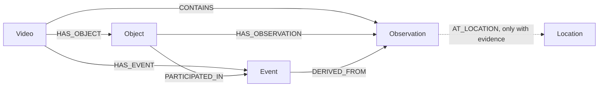

# Temporal visual memory (MVP)

The input is one saved SAM experiment directory containing `metadata.json`,
`observations.json`, and optionally `tracking_summary.json`. The SAM experiment
script and its output format remain unchanged. `ObservationTransformer` validates
the artifacts and produces Pydantic models without accessing Neo4j.

## Graph schema



`Video.video_id`, `Object.object_id`, `Observation.observation_id`,
`Location.location_id`, and `Event.event_id` have uniqueness constraints.
Indexes cover object lookup by video/tracking ID, observation chronology, and
event chronology. `Location` is defined but no location nodes or
`AT_LOCATION` relationships are generated from SAM boxes alone.

Object IDs hash `(video_id, tracking_id)`; observation IDs also include the
frame index. Thus SAM ID `0` in two recordings produces distinct objects.
These are tracking identities scoped to one recording, not verified physical
identities across videos or after a visibility gap.

Bounding boxes are `[left, top, right, bottom]` pixel coordinates with exclusive
right/bottom edges. Source frame timestamps become integer milliseconds relative
to recording start. Neo4j stores a box as a four-integer list. Evidence URIs
point at the saved raw SAM response when that file exists. Missing confidence
remains absent. `Video.created_at` comes from the experiment metadata.

## Events

- `APPEARED`: first detected observation for a track.
- `MOVED`: center displacement reaches the configured pixel threshold, measured
  from the last significant position. Movement is not inferred across a frame gap.
- `NO_LONGER_VISIBLE`: missing frames persist for the configured duration.
  Its interval begins at the first missed frame and ends at the next detection
  or recording end. It reports detection loss, not physical disappearance.

Defaults are 50 pixels and 1000 milliseconds. Events use stable IDs and link to
the observations supporting their boundaries. A gap without enough duration
produces no visibility event. No semantic locations or LLM interpretations are inferred here; spatial relationships are a
separate layer (`spatial-memory.md`).

## Ingest a saved experiment

Set `NEO4J_URI`, `NEO4J_USERNAME`, and `NEO4J_PASSWORD` in the process
environment. `NEO4J_DATABASE` is optional. From the repository root:

```bash
backend/.venv/bin/python backend/scripts/ingest_memory.py \
  backend/outputs/sam_experiments/mug_20261027_164421_488542 \
  --video-id mug_demo
```

Use `--movement-threshold-px` and `--missing-threshold-ms` to change event
thresholds. Ingestion creates the schema if needed, then writes the video,
objects, observations, and events in one transaction. Node IDs and `MERGE`
make repeating the same ingestion idempotent. Changing thresholds for the
same video may add new event IDs; use a new video ID for a distinct analysis.

`Neo4jMemoryRepository` provides `get_video_objects`, `get_object_history`,
`get_video_events`, `get_last_observed_position`, and `get_moved_objects`.
Results are plain dictionaries ordered by time where applicable.
